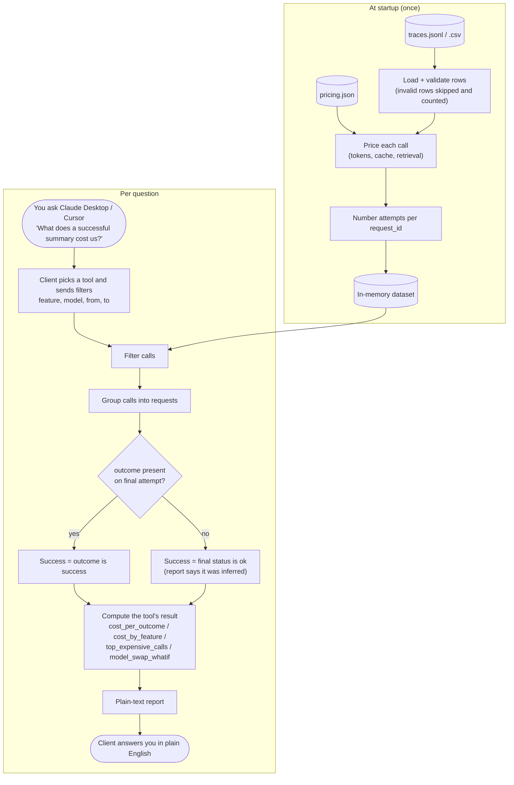

# cost-per-outcome-mcp

**Ask your LLM trace logs what a successful request actually costs.**

A small, read-only MCP server. Point it at a JSONL or CSV export of your LLM calls, then ask Claude Desktop or Cursor cost questions in plain English:

> "What does a successful summary cost us?"
> "Which feature burns the most on retries?"
> "What do we save if `classify` moves to a smaller model?"


```bash
# No data yet? Run it on the bundled synthetic sample:
npx -y cost-per-outcome-mcp

# Your own export (any .jsonl or .csv in the trace schema below):
npx -y cost-per-outcome-mcp --trace ./traces.jsonl
```

The server speaks MCP over stdio, so on its own it just waits for a client. Add it to Claude Desktop or Cursor (see [Install](#install)), or poke at it with `npx @modelcontextprotocol/inspector npx -y cost-per-outcome-mcp`.

---

## Why this exists

Most LLM cost dashboards show **cost per request**. That number lies.

A request that retried twice, timed out, or returned an answer nobody could use still cost money. The number that matters is **cost per successful outcome**: total spend divided by requests that actually did their job.

The gap between those two numbers is usually where the savings are. This server makes that gap visible on your own logs in about two minutes.

---

## Tools

| Tool | Answers | Key output |
|---|---|---|
| `cost_by_feature` | Where is the money going? | Spend per feature/endpoint, split by model and cost layer |
| `cost_per_outcome` | What does *success* cost? | Cost per request vs cost per successful request, with retry and failure overhead |
| `top_expensive_calls` | Which calls are bloated? | The N most expensive calls, with input token size and share of total spend |
| `model_swap_whatif` | What if we switch models? | Estimated monthly savings for moving feature X from model A to model B |

All four tools accept optional `feature`, `model`, `from`, and `to` filters. `from` is inclusive, `to` is exclusive, and a plain date like `2026-09-30` covers that whole day.

Two tools take extra arguments:

| Tool | Extra arguments |
|---|---|
| `top_expensive_calls` | `n`: how many calls to return (default 10, max 100) |
| `model_swap_whatif` | `feature` (required), `target_model` (required, must be in the pricing table), `model` (optional: the model to move away from; default is every model the feature uses except the target) |

Mistakes such as a bad date or an unknown target model come back as a tool error with a message the model can act on. A filter that matches nothing is not an error: the reply lists the features, models and time range that do exist.

### `cost_per_outcome` — the one to run first

```text
> What does a successful summary cost us?

Feature: summarize   (29.7 days)
─────────────────────────────────────────────────────────
Requests                 120
Calls (incl. retries)    140       +20 retry calls
Successful outcomes      107       89.2%
Total spend              $3.43

Cost per request         $0.0286
Cost per success         $0.0321   ← +12% vs per-request

Overhead breakdown
  Retries                $0.49     14%
  Failed requests        $0.37     11%
```

This is the real output on the bundled synthetic sample, so the zero-config demo shows exactly this.

Cost per request says $0.0286. What you actually pay for a summary that works is $0.0321. That 12% is spend with nothing to show for it.

The report also ends with `Note:` lines for data-quality caveats: outcomes that were inferred, models missing from the pricing table, skipped rows, and the pricing date.

### `model_swap_whatif`

Uses **observed token volumes** for the feature, re-priced against the target model from the pricing table, then scaled to a 30-day month.

It estimates **cost only**. It does not know if the cheaper model is good enough for your task. Treat the output as "worth testing," not "safe to ship." Validate against your evals before switching.

---

## How it works

The trace and pricing files are read **once at startup**. After that, every question is answered from memory.



Nothing is written to disk and nothing goes over the network. The only output is the text report sent back to your MCP client over stdio.

---

## Install

### Claude Desktop

Add to `claude_desktop_config.json`:

```json
{
  "mcpServers": {
    "cost-per-outcome": {
      "command": "npx",
      "args": ["-y", "cost-per-outcome-mcp"],
      "env": {
        "COST_TRACE_PATH": "/absolute/path/to/traces.jsonl"
      }
    }
  }
}
```

Restart Claude Desktop. The four tools show up under the 🔌 menu.

### Cursor

Add to `.cursor/mcp.json` in your project (or `~/.cursor/mcp.json` globally):

```json
{
  "mcpServers": {
    "cost-per-outcome": {
      "command": "npx",
      "args": ["-y", "cost-per-outcome-mcp"],
      "env": {
        "COST_TRACE_PATH": "./traces.jsonl"
      }
    }
  }
}
```

Relative paths resolve against the server's working directory, which depends on the client. Prefer an absolute path or `~/…`.

### Try it without your own data

Leave `COST_TRACE_PATH` unset. The server loads the bundled synthetic trace (~500 calls across 4 features, 3 models, with realistic retry and failure rates).

---

## Configuration

| Env var / flag | Default | Purpose |
|---|---|---|
| `COST_TRACE_PATH` / `--trace` | bundled sample | Path to `.jsonl` or `.csv` trace file |
| `COST_PRICING_PATH` / `--pricing` | bundled `pricing.json` | Override the pricing table |
| `COST_PERIOD_DAYS` / `--period-days` | inferred from timestamps | Window used to project monthly figures |
| `COST_CURRENCY` | `USD` | Display only; no FX conversion |

---

## Trace schema

One row per **LLM call**. Rows that share a `request_id` are one logical request (the original attempt plus its retries).

| Field | Type | Required | Notes |
|---|---|---|---|
| `ts` | ISO 8601 string | ✅ | Call start time |
| `request_id` | string | ✅ | Groups retries into one request |
| `feature` | string | ✅ | Feature or endpoint, e.g. `summarize`, `/api/chat` |
| `model` | string | ✅ | Must match a key in the pricing table |
| `input_tokens` | int | ✅ | |
| `output_tokens` | int | ✅ | |
| `cached_input_tokens` | int | | Billed at the cached rate if the model has one |
| `attempt` | int | | 1 = first try. Defaults to order within `request_id` |
| `status` | `ok` \| `error` \| `timeout` | ✅ | Did the API call itself succeed? |
| `outcome` | `success` \| `failure` | | Did the request do its job? Set on the final attempt only |
| `retrieval_cost_usd` | float | | Embedding / vector query cost attributed to this call |
| `cost_usd` | float | | If present, overrides computed token cost |
| `latency_ms` | int | | Reported by `top_expensive_calls` |

**`status` vs `outcome`:** `status: ok` means the API returned 200. `outcome: success` means the result was usable (passed validation, parsed correctly, user didn't regenerate). If `outcome` is missing, the server falls back to "final attempt has `status: ok`" and says so in its output.

### JSONL example

```jsonl
{"ts":"2026-09-14T10:02:11Z","request_id":"r_8812","feature":"summarize","model":"model-large","input_tokens":6120,"output_tokens":410,"status":"timeout","attempt":1}
{"ts":"2026-09-14T10:02:44Z","request_id":"r_8812","feature":"summarize","model":"model-large","input_tokens":6120,"output_tokens":388,"status":"ok","attempt":2,"outcome":"success","retrieval_cost_usd":0.0004}
```

### CSV

Same field names as the header row. Empty cells are treated as missing.

```csv
ts,request_id,feature,model,input_tokens,output_tokens,cached_input_tokens,attempt,status,outcome,retrieval_cost_usd,cost_usd,latency_ms
```

---

## How cost is calculated

Every call is split into the same three **cost layers** I use in audits:

| Layer | Source |
|---|---|
| **Tokens** | `input_tokens`, `cached_input_tokens`, `output_tokens` × pricing table, for first attempts |
| **Retrieval** | `retrieval_cost_usd` (0 if absent), for first attempts |
| **Retries** | Full cost of every call where `attempt > 1` |

The layers don't overlap, and they add up to total spend.

Then:

```
cost_per_request = Σ cost(all calls) / count(distinct request_id)
cost_per_success = Σ cost(all calls) / count(request_id where outcome = success)
overhead_pct     = cost_per_success / cost_per_request − 1
```

The numerator is the same in both. Failed and retried spend is **not** dropped; it's spread across the requests that worked, because that's what you actually paid for them.

The overhead breakdown in `cost_per_outcome` is also non-overlapping: **Retries** is the cost of `attempt > 1` calls inside successful requests, and **Failed requests** is the full cost of every call in requests that failed.

### Edge cases

- `input_tokens` includes `cached_input_tokens`; only the remainder is billed at the full input rate. A row where cached tokens exceed input tokens is invalid.
- Models without a `cached_input` price bill cached tokens at the input rate.
- `cost_usd` replaces the computed token cost; `retrieval_cost_usd` is still added on top.
- If `attempt` is missing, calls are numbered 1..n within each `request_id` by `ts` (file order breaks ties). Numbering happens once over the whole trace, before any filter, so filters never renumber attempts.
- `from` is inclusive and `to` is exclusive; a plain date for `to` covers that whole day.
- Monthly figures are observed cost × `30 / period days`. The period is `--period-days` if set; otherwise it is the span of the trace inside `from`/`to`, ignoring `feature` and `model` filters so a sparse feature isn't over-projected.
- Invalid rows are skipped and counted, never silently dropped. Reports show the count and the first error. A missing or unreadable file, a malformed CSV, or a file with no valid rows stops the server at startup.
- `model_swap_whatif` compares token cost only, because retrieval cost doesn't change with the model. Calls on models missing from the pricing table are left out and counted.
- Calls on models missing from the pricing table get a token cost of 0 and are flagged in every report, never priced silently.

---

## Pricing table

`pricing.json` is bundled and date-stamped. Prices are USD per 1M tokens.

```json
{
  "as_of": "2026-10-01",
  "models": {
    "model-large": { "input": 3.00, "cached_input": 0.30, "output": 15.00 },
    "model-small": { "input": 0.25, "cached_input": 0.03, "output": 1.25 }
  }
}
```

**Provider prices change.** Check `as_of`. For anything you'll act on, override with `COST_PRICING_PATH` using your actual contracted rates (including Bedrock regional pricing, batch discounts, or committed-use deals).

Unknown model names are reported, not silently priced at zero.

---

## Read-only by design

- **No network calls.** The server reads one local file and one pricing table. Nothing leaves your machine except what your MCP client sends to its model.
- **No writes.** It never modifies the trace file or creates new files.
- **No credentials.** It doesn't need, ask for, or read API keys.

That said, tool output goes to whatever model your MCP client uses. If your traces contain prompt text, strip it before loading. The schema above doesn't need it.

---

## Exporting traces from your stack

| Source | Quick path |
|---|---|
| **Bedrock invocation logs** | Athena query over the S3 log bucket → CSV. Map `modelId` → `model`, `input.inputTokenCount` → `input_tokens`, `output.outputTokenCount` → `output_tokens` |
| **OpenAI / Anthropic SDK** | Log `usage` from each response alongside your own `request_id` and `feature` tag |
| **LiteLLM / proxy logs** | Export spend logs; `call_type` or route usually maps to `feature` |
| **Langfuse / Helicone** | Export to CSV and map columns (native connectors are on the roadmap) |

The hard part is usually `outcome`. If you don't record it today, start with "final attempt returned 200 and parsed." It's a floor, not the truth, but it's better than cost per request.

---

## Limitations

- Batch file analysis, not live monitoring.
- `model_swap_whatif` assumes the target model uses the same token counts. Tokenizers differ; expect ±10–20% drift.
- No quality signal. A cheaper model that fails more often can cost more per success. Re-run `cost_per_outcome` on a test batch after any swap.
- Monthly projections assume the trace window is representative.

---

## Next

Not in v0.1, on the list:

- [ ] Langfuse and Helicone connectors
- [ ] Bedrock invocation log reader (direct from S3)
- [ ] Prompt-cache hit rate per feature
- [ ] Context-bloat detector (input token drift over time)
- [ ] `quality_adjusted_whatif`: fold eval pass rates into swap estimates

PRs welcome. Open an issue first for anything bigger than a bug fix.

---

## Development

```bash
git clone https://github.com/<your-handle>/cost-per-outcome-mcp
cd cost-per-outcome-mcp
npm install
npm run build
npm run dev -- --trace ./data/sample-traces.jsonl

# Typecheck, unit tests, and end-to-end tests over real stdio
npm run typecheck
npm test
npm run test:e2e

# Regenerate the synthetic trace
npm run gen:sample

# Inspect tools interactively
npx @modelcontextprotocol/inspector node dist/index.js
```

Built with the TypeScript MCP SDK over stdio.

---

## Want this done on production traces?

This tool shows you the gap. Closing it means knowing which fixes are safe: prompt trimming, caching, routing, model swaps, each tested against your real requests so quality doesn't drop.

I do that as a one-week, read-only **AI Cost Audit** for seed–Series B SaaS teams on Bedrock or direct model APIs. You get every fix ranked by $/month, and you keep the findings whether we work together or not.

**→ [See the AI Cost Audit](https://ankitjha.pro/ai-cost-audit)**

---

## License

MIT